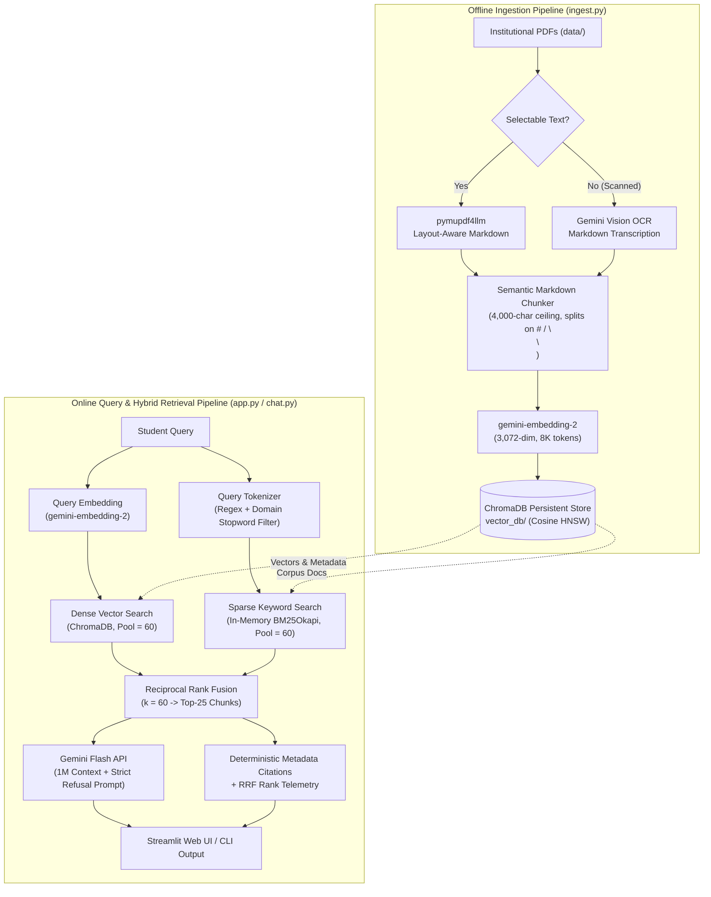

# NITP-RAG: Institutional Hybrid Retrieval-Augmented Generation System

An end-to-end **Hybrid RAG system built from scratch in Python** (no orchestration frameworks such as LangChain or LlamaIndex) for answering student and administrative queries over **NIT Patna** institutional PDFs—including multi-column fee notices, exam schedules, academic ordinances, JRF advertisements, holiday calendars, and NIRF faculty registries.

> **M.Tech Thesis Project** — Dept. of Computer Science & Engineering, NIT Patna  
> **Author:** Mithilesh Kumar (2246022) | **Supervisor:** Prof. M.P. Singh

---

## Key Features

* **Framework-Free Modular Architecture:** Full control over PDF parsing, chunk boundaries, tokenization, rank fusion, and citation generation.
* **Table-Preserving Ingestion:** Uses `pymupdf4llm` to convert PDF tables into structured Markdown grids (`| Col1 | Col2 |`), with Gemini Vision OCR support for image-only scanned notices.
* **Zero-Truncation Cloud Embeddings:** Uses `gemini-embedding-2` (8,192-token capacity, 3,072 dimensions) to index complete 4,000-character table chunks without dropping lower rows.
* **Dual-Engine Hybrid Search + RRF:** Combines dense semantic search (`ChromaDB` cosine similarity) and sparse keyword search (`BM25Okapi` with HTML sanitization and query-time domain stopword filtering) fused via **Reciprocal Rank Fusion ($k=60$)**.
* **Grounded Generation & Deterministic Citations:** Strictly grounded Gemini Flash generation with automated model fallback and deterministic source badges pulled directly from vector store metadata (never LLM-fabricated).
* **Interactive Web UI & Quantitative Evaluation:** Streamlit chat interface (`app.py`) with configurable Top-K retrieval and expandable Vector/BM25/RRF rank diagnostics, plus an automated 30-query benchmark (`evaluate.py`).

---

## System Architecture



---

## Current AI Workflow

### 1. Offline Ingestion (`ingest.py`)
1. **PDF Extraction:** Vector PDFs are converted into Markdown tables via `LocalPDFParser` (`pymupdf4llm`), preserving column headers and row alignment. Image-only scanned notices (e.g., `FEE_PG_2024_25.pdf`) are transcribed via Gemini Vision OCR.
2. **Semantic Chunking (`src/processing/chunker.py`):** Splits documents on structural Markdown boundaries (`\n#`, `\n##`, `\n\n`) and packs blocks up to a **4,000-character ceiling**, keeping multi-row tables contiguous.
3. **Embedding (`src/embeddings/generator.py`):** Embeds full chunks with `gemini-embedding-2` (3,072 dimensions, 8,192-token limit) with exponential backoff retry handling for API rate limits (`429`).
4. **Idempotent Storage (`src/storage/vector_store.py`):** Upserts chunk text, vectors, and source metadata (`source`, `page_number`, `chunk_index`) into persistent ChromaDB (`vector_db/`).

### 2. Online Retrieval & Generation (`app.py` / `chat.py`)
1. **Dual-Engine Candidate Retrieval (`k_retrieve = 60`):**
   * **Dense Search:** Queries ChromaDB with the 3,072-dim query embedding using cosine distance.
   * **Sparse Search:** Runs in-memory `BM25Okapi` after stripping punctuation/HTML tags (`<br>`, `<sup>`) and conditionally discounting corpus-wide institutional boilerplate (`nit`, `patna`, `institute`) at query time when specific intent terms exist.
2. **Reciprocal Rank Fusion (`k = 60`):**
   $$\text{RRF}(d) = \frac{1}{60 + \text{rank}_{\text{Dense}}(d)} + \frac{1}{60 + \text{rank}_{\text{BM25}}(d)}$$
   Selects the **Top-25 chunks** (~25K tokens, <3% of Gemini Flash's 1M context window).
3. **Grounded Generation (`src/generation/llm.py`):** Sends retrieved context to Gemini Flash with an automatic model fallback cascade (`gemini-3.5-flash-lite` -> `gemini-flash-lite-latest` -> `gemini-2.5-flash`) and strict grounding instructions (*"I don't know based on the provided document"* when evidence is absent).
4. **Deterministic Source Attribution:** Extracts cited document filenames directly from ChromaDB metadata and renders per-chunk Vector Rank, BM25 Rank, and RRF Score diagnostics in the UI.

---

## Key Engineering Problems Solved

| Challenge | Root Cause Identified | Implemented Fix |
|---|---|---|
| **Broken Tables** | Linear PDF parsing (`pypdf`) stripped grid geometry and 400-char chunking detached headers from row values. | Switched to `pymupdf4llm` Markdown extraction + 4,000-char boundary-aware semantic chunking. |
| **Silent 75% Row Drop** | Local `all-MiniLM-L6-v2` had a 256-token (`max_seq_length`) ceiling and silently truncated long table chunks. | Upgraded to `gemini-embedding-2` (8K-token limit, 3,072-dim) and re-indexed ChromaDB. |
| **Local Hardware Freeze** | Local `Llama-3 8B` via Ollama consumed ~98% of 16 GB RAM on long table contexts. | Migrated inference to Gemini Flash API with multi-model fallback and campus-proxy SSL handling. |
| **Exact-Entity Vector Dilution** | Dense embeddings diluted specific titles (e.g., *"Director"*) inside 35-row faculty tables (Vector Rank #63/72), while *"NIT Patna"* boilerplate polluted BM25. | Built Hybrid Search (`ChromaDB + BM25 + RRF`), added query-time domain stopword filtering, expanded pool to 60, and set retrieval to Top-25. |

---

## Quantitative Benchmark Results

Evaluated via [`evaluate.py`](evaluate.py) on [`evaluation/dataset.json`](evaluation/dataset.json) (**30 ground-truth queries**: 25 factual benchmark queries + 5 negative guardrail traps) across **10 indexed NIT Patna PDFs (76 chunks)**:

* `Fee_structure.pdf` (UG), `FEE_PG_2024_25.pdf` (M.Tech), `FEE_MCA_REGULAR.pdf`, `FEE_MCA_SELF_FINANCE.pdf`, `PhD_fee_Structure_29_07_2026.pdf`, `MSE July Dec 2026 Schedule _Reg.xlsx.pdf`, `NIRF_Data_2026.pdf`, `UG Regulation 2022.pdf`, `JRF_Advertisement_2026.pdf`, `Holiday_Academic.pdf`.

| Retrieval Engine | Hit@1 (%) | Hit@5 (%) | Hit@10 (%) | Hit@20 (%) | MRR | Avg Retrieval Latency |
|---|:---:|:---:|:---:|:---:|:---:|:---:|
| **Dense Vector (Baseline)** | 68.0% | 80.0% | 84.0% | 84.0% | 0.716 | 583.6 ms |
| **Sparse BM25 (Baseline)** | 60.0% | 84.0% | 92.0% | 100.0% | 0.712 | 0.3 ms |
| **Hybrid RRF (Proposed)** | **68.0%** | **88.0%** | **88.0%** | **96.0%** | **0.771** | **584.1 ms** |

**Key Takeaways:**
* **+7.7% MRR improvement** over pure dense vector search (`0.771` vs. `0.716`) and **+8.3% MRR improvement** over pure BM25 (`0.771` vs. `0.712`).
* **+12% Hit@20 gain** over pure dense vector search (`96.0%` vs. `84.0%`).
* **Sub-millisecond BM25 overhead:** In-memory BM25 adds only **0.3 ms** on top of dense vector retrieval.
* Full report and LaTeX table available in [`evaluation/results.md`](evaluation/results.md).

---

## Project Structure

```text
NITP-RAG System/
├── app.py                        # Streamlit Web UI (chat, Top-K slider, citations, RRF breakdown)
├── chat.py                       # Interactive CLI chat interface
├── ingest.py                     # PDF ingestion, semantic chunking, and embedding pipeline
├── evaluate.py                   # Quantitative retrieval benchmark (Hit@K, MRR, latency)
├── requirements.txt              # Python dependencies
├── evaluation/
│   ├── dataset.json              # 30-query ground-truth benchmark dataset
│   └── results.md                # Empirical benchmark report & LaTeX table
├── src/
│   ├── ingestion/
│   │   ├── local_parser.py       # pymupdf4llm Markdown table parser
│   │   ├── api_parser.py         # Gemini Vision OCR parser for scanned PDFs
│   │   └── pdf_parser.py         # Legacy pypdf baseline parser
│   ├── processing/
│   │   └── chunker.py            # Boundary-aware semantic Markdown chunker
│   ├── embeddings/
│   │   └── generator.py          # GeminiEmbedder (gemini-embedding-2) & legacy LocalEmbedder
│   ├── storage/
│   │   └── vector_store.py       # ChromaDB + BM25Okapi + Hybrid Search with RRF (k=60)
│   └── generation/
│       └── llm.py                # GeminiLLM with fallback cascade & legacy LocalLLM (Ollama)
├── data/                         # Local PDF circulars (git-ignored)
└── vector_db/                    # Persistent ChromaDB storage (git-ignored)
```

---

## Quick Start

### 1. Clone & Setup Environment
```bash
git clone https://github.com/mithilesh1729/NITP-RAG-System.git
cd NITP-RAG-System
python -m venv venv

# Windows PowerShell
.\venv\Scripts\Activate.ps1
# Linux / macOS
# source venv/bin/activate

pip install -r requirements.txt
```

### 2. Configure API Key
Create a `.env` file in the project root:
```env
GEMINI_API_KEY=your_gemini_api_key_here
```

### 3. Ingest Documents
Place institutional PDF circulars inside `data/` and run:
```bash
python ingest.py
```

### 4. Run the Application
**Streamlit Web UI (Recommended):**
```bash
streamlit run app.py
```
Open `http://localhost:8501` in your browser.

**CLI Chat Interface:**
```bash
python chat.py
```

### 5. Run the Quantitative Evaluation Benchmark
```bash
python evaluate.py
```
